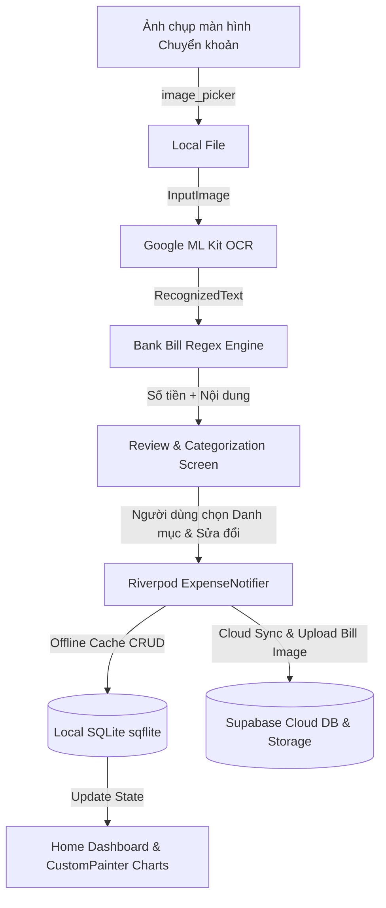
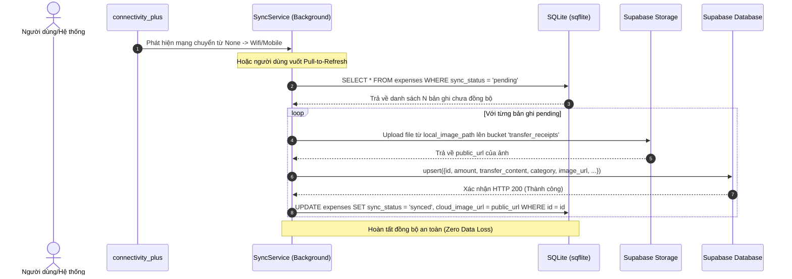

# Product Requirements Document (PRD)
## Project: VKU Bank Transfer OCR & Expense Tracker (Mini-Project 3)

---

### 1. Executive Summary

* **Problem Statement:**
  Sinh viên và ban chủ nhiệm câu lạc bộ tại VKU hiện nay thực hiện hầu hết các giao dịch thanh toán chi tiêu (tiền ăn uống, sinh hoạt, quỹ câu lạc bộ, tài liệu học tập, tiền trọ) thông qua **chuyển khoản ngân hàng** (MB Bank, Vietcombank, VietinBank, Techcombank, MoMo...). Sau mỗi giao dịch, người dùng đều có ảnh chụp màn hình xác nhận *"Chuyển tiền thành công"*. Việc phải nhập tay lại số tiền, nội dung chuyển khoản và phân loại danh mục vào bảng tính gây tốn nhiều thời gian và dễ thất thoát số liệu.
* **Proposed Solution:**
  Ứng dụng di động Flutter hỗ trợ **quét ảnh chụp màn hình chuyển khoản ngân hàng** hoàn toàn ngoại tuyến bằng Google ML Kit OCR; tự động bóc tách **Số tiền giao dịch** và **Nội dung chuyển khoản** qua bộ phân tích Regex Heuristics chuyên biệt cho biên lai ngân hàng Việt Nam; cung cấp **màn hình Review & Xác thực** để người dùng kiểm tra và **chọn danh mục chi tiêu** (kèm cơ chế gợi ý danh mục thông minh theo nội dung giao dịch); lưu trữ đồng bộ dữ liệu lên **Supabase (Cloud Database + Supabase Storage lưu ảnh)** kết hợp **Local SQLite Cache (Offline-First)** và trực quan hóa chi tiêu bằng biểu đồ hoạt họa 120 FPS vẽ bằng `CustomPainter`.
* **Success Criteria:**
  1. **Tỷ lệ nhận diện bóc tách thành công (Extraction Rate):** Đạt $\ge 90\%$ bóc tách chính xác Số tiền giao dịch và Nội dung chuyển khoản trên các ảnh chụp màn hình app ngân hàng phổ biến tại Việt Nam (MB Bank, VCB, VietinBank, Techcombank, MoMo).
  2. **Thời gian xử lý OCR trên thiết bị (Inference Latency):** Thời gian từ khi chọn ảnh chụp màn hình đến khi hiển thị kết quả trên màn hình Review $\le 1.200\text{ ms}$.
  3. **Tối ưu hóa hiệu năng render biểu đồ:** Đạt ổn định $60\text{--}120\text{ FPS}$ (khung hình xử lý trong ngân sách $\le 8.33\text{ ms}$ trên màn hình ProMotion/120Hz) khi animation vẽ Donut Chart và Bar Chart.
  4. **Điểm đánh giá đồ án môn học:** Đạt trọn vẹn $10.0/10.0$ điểm theo Rubric của học phần Cross-Platform Mobile App Development VKU.

---

### 2. User Experience & Functionality

#### 2.1 User Personas
* **Persona 1 - Thủ quỹ lớp / Ban chủ nhiệm CLB VKU:**
  * Thường xuyên chuyển khoản thanh toán đồ dùng, địa điểm sự kiện, liên hoan và lưu lại ảnh chụp màn hình bill ngân hàng làm chứng từ.
  * *Nhu cầu:* Quét hàng loạt ảnh chụp màn hình chuyển khoản, tự động trích xuất nội dung và số tiền, gán danh mục quỹ để xuất báo cáo minh bạch cho cả nhóm.
* **Persona 2 - Sinh viên quản lý tài chính cá nhân:**
  * Thanh toán quét mã QR/chuyển khoản hàng ngày (tiền ăn trưa, cà phê, tiền trọ, xăng xe, mua sắm online).
  * *Nhu cầu:* Chọn ảnh chụp màn hình giao dịch vừa chuyển khoản xong $\rightarrow$ App tự lấy số tiền & nội dung $\rightarrow$ Chọn nhanh danh mục $\rightarrow$ Lưu lại để theo dõi ngân sách chi tiêu hàng tuần/tháng.

#### 2.2 User Stories & Acceptance Criteria

##### Epic 1: Thu thập & Nhận diện Ảnh chụp màn hình chuyển khoản (Capture & OCR)
* **User Story 1:**
  *Là người dùng, tôi muốn chọn ảnh chụp màn hình chuyển khoản từ Thư viện ảnh (hoặc chụp trực tiếp) để ứng dụng tự động đọc các trường dữ liệu trên biên lai.*
  * **Acceptance Criteria (AC 1.1):** Cho phép chọn ảnh biên lai chuyển khoản từ Thư viện (Gallery) hoặc chụp từ Camera thông qua `image_picker`.
  * **Acceptance Criteria (AC 1.2):** Xử lý nhận diện văn bản hoàn toàn On-Device (ngoại tuyến) bằng `google_mlkit_text_recognition`, không gửi ảnh lên API nhận dạng bên ngoài.
  * **Acceptance Criteria (AC 1.3):** Lưu trữ ảnh biên lai cục bộ và hỗ trợ upload lên **Supabase Storage** (bucket: `transfer_receipts`) để đồng bộ đám mây.

##### Epic 2: Bóc tách Số tiền & Nội dung Chuyển khoản (Bank Transfer Regex Engine)
* **User Story 2:**
  *Là người dùng, tôi muốn hệ thống tự động bóc tách chính xác Số tiền, Nội dung chuyển tiền, Ngày giờ và Thông tin người nhận từ ảnh biên lai chuyển khoản ngân hàng.*
  * **Acceptance Criteria (AC 2.1 - Bóc tách Số tiền):** Nhận diện số tiền giao dịch nổi bật (ví dụ: `95,000 VND`, `150.000 đ`, `2,500,000 VND`), loại bỏ ký hiệu tiền tệ và chuyển đổi chính xác thành kiểu số thực (`double`).
  * **Acceptance Criteria (AC 2.2 - Bóc tách Nội dung chuyển tiền):** Trích xuất chính xác dòng nội dung/lời nhắn giao dịch (ví dụ: *"NGUYEN QUANG NHAN chuyen tien"*, *"tien an trua"*, *"dong quy thang 10"*).
  * **Acceptance Criteria (AC 2.3 - Bóc tách Ngày giờ & Đối tác):** Trích xuất thời gian giao dịch (`13:30 - 05/10/2026`) và tên người nhận (`HOANG THI THANH THO - Vietinbank (CTG)`).
  * **Acceptance Criteria (AC 2.4 - Gợi ý danh mục thông minh - Smart Suggestion):** Phân tích nội dung chuyển khoản để gợi ý danh mục ban đầu:
    * Có từ khóa `an`, `com`, `cafe`, `tra sua`, `food`, `lau`, `nuoc` $\rightarrow$ **Ăn uống**
    * Có từ khóa `tro`, `dien`, `nuoc`, `wifi`, `internet`, `phong` $\rightarrow$ **Tiện ích / Nhà trọ**
    * Có từ khóa `xang`, `grab`, `be`, `xe`, `ve xe` $\rightarrow$ **Di chuyển**
    * Có từ khóa `sach`, `hoc phi`, `tai lieu`, `in an`, `hoc` $\rightarrow$ **Học tập**
    * Có từ khóa `ao`, `quan`, `shopee`, `lazada`, `mua`, `shop` $\rightarrow$ **Mua sắm**

##### Epic 3: Màn hình Xem lại & Chọn danh mục chi tiêu (Review & Categorization Screen)
* **User Story 3:**
  *Là người dùng, sau khi OCR quét xong, tôi muốn kiểm tra lại thông tin và CHỌN DANH MỤC TIÊU SÀI cho bill đó trước khi lưu để dữ liệu được phân loại chuẩn xác.*
  * **Acceptance Criteria (AC 3.1):** Màn hình hiển thị:
    * Ảnh thu nhỏ của biên lai chuyển khoản vừa quét.
    * Ô nhập liệu **Số tiền chuyển** (đã điền sẵn từ OCR, cho phép chỉnh sửa).
    * Ô nhập liệu **Nội dung chuyển khoản** (đã điền sẵn từ OCR, cho phép chỉnh sửa).
    * Trường **Thời gian giao dịch** & **Người nhận/Ngân hàng nhận**.
  * **Acceptance Criteria (AC 3.2 - Chọn Danh mục):** Cung cấp bộ chọn danh mục trực quan (Category Chip selector hoặc Dropdown) gồm: *Ăn uống, Tiện ích/Nhà trọ, Di chuyển, Mua sắm, Học tập, Khác*. Danh mục được tự động chọn trước theo gợi ý thông minh (AC 2.4) nhưng người dùng có thể đổi tùy ý chỉ bằng một chạm.
  * **Acceptance Criteria (AC 3.3):** Form sử dụng `GlobalKey<FormState>()` kiểm tra tính hợp lệ: Số tiền $> 0$, Nội dung và Danh mục không được để trống.
  * **Acceptance Criteria (AC 3.4):** Bấm "Xác nhận lưu" $\rightarrow$ Hiển thị thông báo `SnackBar` $\rightarrow$ Đẩy dữ liệu vào State/Database $\rightarrow$ Điều hướng về màn hình chính (`context.pop()`).

##### Epic 4: Lưu trữ Đám mây Supabase & Cache Cục bộ SQLite (Offline-First Architecture)
* **User Story 4:**
  *Là người dùng, khi điện thoại mất mạng tôi vẫn muốn chụp/chọn ảnh lưu chi tiêu bình thường, và khi máy có mạng trở lại thì hệ thống phải tự động đẩy cả ảnh và dữ liệu lên Supabase mà không làm mất thông tin.*
  * **Acceptance Criteria (AC 4.1 - Lưu trữ khi Mất Mạng / Offline Storage):**
    * **Vị trí lưu ảnh:** File ảnh chụp màn hình được copy và lưu an toàn vào bộ nhớ nội bộ ứng dụng: `getApplicationDocumentsDirectory() + /receipts/<id>.jpg`.
    * **Vị trí lưu dữ liệu:** Ghi bản ghi chi tiêu trực tiếp vào bảng SQLite (`sqflite`), gán trường `sync_status = 'pending'`, `local_image_path = <đường_dẫn_nội_bộ>`, `cloud_image_url = null`.
    * **Hiển thị tức thời:** Riverpod Notifier đọc ngay từ SQLite để cập nhật danh sách và vẽ biểu đồ ngay lập tức (không bị đơ, không phụ thuộc mạng).
  * **Acceptance Criteria (AC 4.2 - Cơ chế Tự động Đẩy Dữ liệu Khi Có Mạng / Online Sync):**
    * **Kích hoạt tự động (Auto-Trigger):** Lắng nghe trạng thái mạng qua `connectivity_plus`. Ngay khi chuyển từ `none` sang `wifi`/`mobile` (hoặc khi người dùng mở lại app / vuốt Pull-to-refresh), `SyncService` tự động chạy ngầm.
    * **Tiến trình Upload 2 bước:**
      1. Đẩy file ảnh từ `local_image_path` lên **Supabase Storage** (bucket: `transfer_receipts`) $\rightarrow$ nhận về `public_url`.
      2. Đẩy thông tin giao dịch (số tiền, nội dung, danh mục, thời gian, `image_url`) lên bảng `expenses` trên **Supabase PostgreSQL**.
    * **Xác nhận hoàn tất:** Sau khi Supabase xác nhận thành công, SQLite cục bộ cập nhật cờ `sync_status = 'synced'` và lưu `cloud_image_url`.
    * **Chống mất dữ liệu (Fault Tolerance):** Nếu rớt mạng giữa chừng, trạng thái giữ nguyên `'pending'` và tự động thử lại (Retry) ở lần kết nối mạng tiếp theo; tuyệt đối không xóa dữ liệu cục bộ.
  * **Acceptance Criteria (AC 4.3 - Quản lý State bằng Riverpod 2):** Sử dụng `NotifierProvider` quản lý danh sách chi tiêu, đảm bảo phản ứng tức thì khi thêm/sửa/xóa.
  * **Acceptance Criteria (AC 4.4):** Hiển thị danh sách bằng `ListView.builder` kết hợp `Dismissible` với `ValueKey(item.id)` để xóa giao dịch mượt mà.

##### Epic 5: Trực quan hóa Biểu đồ (CustomPainter Animation Charts)
* **User Story 5:**
  *Là người dùng, tôi muốn xem biểu đồ Donut Chart phân tích tỷ trọng các danh mục tiêu sài và Biểu đồ cột theo tuần để đánh giá tài chính cá nhân.*
  * **Acceptance Criteria (AC 5.1):** Tự vẽ **Donut Chart** bằng `CustomPainter` (`canvas.drawArc`), hiển thị tỷ lệ % các danh mục tiêu sài (Ăn uống, Tiền trọ, Mua sắm...).
  * **Acceptance Criteria (AC 5.2):** Tích hợp `AnimationController` tạo hiệu ứng quay/mở góc vẽ từ $0^\circ$ đến $360^\circ$ mượt mà khi vào trang báo cáo.
  * **Acceptance Criteria (AC 5.3):** Tự vẽ **Weekly Bar Chart** bằng `CustomPainter` (`canvas.drawRect`) biểu thị tổng tiền chi tiêu theo từng ngày trong tuần.
  * **Acceptance Criteria (AC 5.4):** Tối ưu `shouldRepaint` để không vẽ lại khi dữ liệu không thay đổi.

##### Epic 6: Giao diện Material 3 & Trải nghiệm Người dùng
* **User Story 6:**
  *Là người dùng, tôi muốn giao diện app hiện đại theo phong cách Material 3, hỗ trợ cả Dark Mode và bố cục tiện lợi.*
  * **Acceptance Criteria (AC 6.1):** Cấu hình `ThemeData(useMaterial3: true)` với seed color VKU Navy (`0xFF2C4570`).
  * **Acceptance Criteria (AC 6.2):** Hỗ trợ đầy đủ cả chế độ Sáng (Light Mode) và Tối (Dark Mode).
  * **Acceptance Criteria (AC 6.3):** Điều hướng khai báo bằng `go_router` với cấu trúc `ShellRoute` giữ thanh điều hướng `NavigationBar` cố định.

#### 2.3 Non-Goals
* Không kết nối trực tiếp Open Banking API của các ngân hàng (chỉ đọc thông qua ảnh chụp màn hình biên lai).
* Không thực hiện chuyển khoản ngược lại (không làm chức năng thanh toán).

---

### 3. AI / Machine Learning & Regex Specifications

#### 3.1 Mô hình & Thư viện
* **Thư viện OCR:** `google_mlkit_text_recognition: ^0.11.0` (On-Device, hoạt động hoàn toàn offline).
* **Đối tượng đầu vào:** Ảnh chụp màn hình chuyển khoản ngân hàng Việt Nam (MB, Vietcombank, Vietinbank, Techcombank, MoMo...).
* **Chiến lược phân tích Regex Heuristics:**
  1. *Quy tắc bóc tách Số tiền:*
     * Pattern: `r'(?:[\d]{1,3}(?:[.,]\d{3})*(?:\.\d{2})?)\s*(?:VND|VNĐ|đ|dong)'` hoặc tìm dòng có kích thước chữ lớn nhất chứa cụm số dạng `xx,xxx VND` / `xxx.xxx đ`.
  2. *Quy tắc bóc tách Nội dung chuyển khoản:*
     * Tìm kiếm sau các từ khóa định danh: `nội dung`, `nội dung chuyển tiền`, `lời nhắn`, `thông tin chi tiết`, hoặc dòng văn bản nằm ngay dưới số tài khoản/tên người nhận (ví dụ mẫu MB: `"NGUYEN QUANG NHAN chuyen tien"`).
  3. *Quy tắc bóc tách Thời gian:*
     * Pattern: `r'\d{1,2}:\d{2}\s*[-–]\s*\d{1,2}/\d{1,2}/\d{4}'` (ví dụ `13:30 - 05/10/2026`).

---

### 4. Technical Specifications

#### 4.1 Cấu trúc Mã nguồn (Clean Architecture)

```
lib/
├── core/                  # Hằng số, themes M3 (VKU Navy), tiện ích format tiền tệ/ngày
│   ├── theme/
│   │   ├── app_theme.dart
│   │   └── color_schemes.dart
│   └── utils/
│       ├── currency_formatter.dart
│       └── date_formatter.dart
├── models/                # Thực thể dữ liệu
│   ├── expense_item.dart
│   ├── expense_category.dart
│   └── parsed_bank_bill.dart
├── services/              # Tầng dịch vụ thuần túy
│   ├── ocr_service.dart          # Wrapper cho Google ML Kit
│   ├── bank_bill_parser.dart     # Regex Heuristics bóc tách biên lai ngân hàng
│   ├── database_helper.dart      # Local SQLite CRUD (sqflite)
│   └── supabase_service.dart     # Supabase DB & Storage sync
├── state/                 # State management với Riverpod 2
│   ├── expense_notifier.dart
│   └── theme_notifier.dart
├── widgets/               # Reusable UI components
│   ├── expense_summary_card.dart # Card hiển thị giao dịch (Lab Week 7)
│   ├── category_chip_selector.dart
│   └── charts/
│       ├── animated_donut_chart.dart
│       └── weekly_bar_chart.dart
└── screens/               # Màn hình ứng dụng
    ├── home_screen.dart          # Danh sách giao dịch & tổng quan
    ├── bill_scanner_screen.dart  # Chụp/chọn ảnh chụp màn hình ngân hàng
    ├── review_screen.dart        # Màn hình xác thực & CHỌN DANH MỤC
    └── reports_screen.dart       # Màn hình biểu đồ thống kê
```

#### 4.2 Data Flow Pipeline



#### 4.3 Database Schemas

##### 1. Supabase PostgreSQL Schema:
```sql
CREATE TABLE expenses (
    id UUID PRIMARY KEY DEFAULT gen_random_uuid(),
    amount NUMERIC NOT NULL,
    transfer_content TEXT NOT NULL,
    category TEXT NOT NULL,
    recipient_name TEXT,
    bank_name TEXT,
    transaction_time TIMESTAMP WITH TIME ZONE,
    image_url TEXT,
    created_at TIMESTAMP WITH TIME ZONE DEFAULT NOW()
);
```

##### 2. Local SQLite Schema (`sqflite`):
```sql
CREATE TABLE expenses (
    id TEXT PRIMARY KEY NOT NULL,
    amount REAL NOT NULL,
    transfer_content TEXT NOT NULL,
    category TEXT NOT NULL,
    recipient_name TEXT,
    bank_name TEXT,
    transaction_time TEXT,
    image_path TEXT,
    sync_status TEXT DEFAULT 'synced',
    created_at INTEGER NOT NULL
);
```

#### 4.4 Đặc tả Chi tiết: Cơ chế Lưu trữ Offline & Quy trình Đồng bộ Khi Có Mạng (Offline-First Sync Engine)

##### A. Khi thiết bị KHÔNG CÓ MẠNG (Offline Mode)
1. **Lưu trữ tệp hình ảnh (Image File Storage):**
   * Ảnh chụp màn hình chuyển khoản (từ camera hoặc thư viện) được sao chép ngay vào bộ nhớ trong bảo mật của ứng dụng:
     `{ApplicationDocumentsDirectory}/receipts/{uuid}.jpg`
   * Đường dẫn này được gán vào trường `local_image_path`. Tuyệt đối không xóa cache ảnh gốc khi chưa đồng bộ.
2. **Lưu trữ dữ liệu giao dịch (Local Database):**
   * Thêm bản ghi mới vào SQLite (`sqflite`) với cấu trúc:
     * `id`: UUID chuỗi sinh tự động.
     * `amount`: Số tiền bóc tách (hoặc do người dùng sửa).
     * `transfer_content`: Nội dung chuyển khoản.
     * `category`: Danh mục tiêu sài người dùng đã chọn.
     * `local_image_path`: Đường dẫn ảnh cục bộ trên máy.
     * `cloud_image_url`: `NULL`.
     * `sync_status`: `'pending'` *(Chờ đồng bộ)*.
3. **Cập nhật giao diện (Zero Latency UI):**
   * Riverpod Notifier nhận dữ liệu từ SQLite và cập nhật State lập tức. Màn hình Home và biểu đồ `CustomPainter` hiển thị giao dịch mới ngay mà không cần đợi bất kỳ phản hồi mạng nào.

##### B. Khi thiết bị CÓ MẠNG TRỞ LẠI (Online Synchronization Pipeline)



* **Xử lý sự cố mạng (Fault Tolerance):**
  * Trong trường hợp đang đẩy dữ liệu mà mạng bị ngắt giữa chừng, giao dịch đang xử lý dở sẽ giữ nguyên trạng thái `sync_status = 'pending'`.
  * Cơ chế thử lại (Retry Strategy) với Exponential Backoff sẽ tự động kích hoạt lại ở lần có mạng kế tiếp.
  * Dữ liệu trên SQLite cục bộ luôn đóng vai trò là "Single Source of Truth" không bao giờ bị ghi đè hoặc biến mất khi lỗi mạng.

#### 4.5 Cấu hình Router (GoRouter)
* `/`: Dashboard chính (Tổng chi tiêu, danh sách giao dịch gần đây).
* `/scan`: Màn hình chụp/chọn ảnh bill chuyển khoản.
* `/review`: Màn hình xem lại số tiền, nội dung & **chọn danh mục tiêu sài**.
* `/reports`: Màn hình trực quan hóa biểu đồ `CustomPainter` (Donut & Bar chart).

---

### 5. Rubric, Deliverables & Phased Roadmap

#### 5.1 Thang điểm đánh giá chi tiết (10-Point Grading Rubric)

| Thành phần | Tiêu chí chi tiết | Điểm |
| :--- | :--- | :---: |
| **On-Device OCR & Heuristics** | Chọn/chụp ảnh bill chuyển khoản ngân hàng, ML Kit OCR offline, bộ lọc Regex bóc tách chính xác: **Số tiền** và **Nội dung chuyển khoản**. | **3.5** |
| **Custom Canvas Visualization** | Tự vẽ biểu đồ **Donut Chart** (tỷ trọng các danh mục tiêu sài) có hoạt họa chuyển động mượt mà và **Weekly Bar Chart** bằng `CustomPainter`. | **2.5** |
| **State Management & DB** | Quản lý State bằng Riverpod 2 (`NotifierProvider`), lưu trữ bền vững với **SQLite CRUD** kết hợp đồng bộ **Supabase Cloud & Storage**. | **2.0** |
| **UI/UX Polish** | Áp dụng Material 3, Dark Mode, màn hình Review cho phép kiểm tra số tiền/nội dung và **chọn danh mục tiêu sài** thuận tiện. | **1.0** |
| **Deliverables & Report** | File `app-release.apk` có chữ ký, video demo (2–3 phút), repository GitHub sạch sẽ, báo cáo kỹ thuật PDF (2–4 trang). | **1.0** |

#### 5.2 Deliverables Checklist
* [ ] **1. Signed Release APK (`app-release.apk`):** File cài đặt đã ký, chạy thử mượt trên máy Android thật.
* [ ] **2. Demo Video (2–3 phút):** Quay màn hình: Chọn ảnh bill chuyển khoản thật (MB Bank/VCB...) $\rightarrow$ OCR bóc tách tức thì Số tiền & Nội dung $\rightarrow$ Chọn danh mục tiêu sài $\rightarrow$ Lưu vào SQLite & Supabase $\rightarrow$ Biểu đồ Donut Chart cập nhật mượt mà.
* [ ] **3. GitHub Repository:** Cấu trúc Clean Architecture, commit sạch sẽ, kèm file `README.md`.
* [ ] **4. Short Technical Report (PDF, 2–4 trang):** Sơ đồ kiến trúc, bảng quy tắc Regex cho bill chuyển khoản, ảnh Light/Dark mode.
* ⏰ **Deadline:** Cuối tuần 8 (Chủ Nhật, 23:59).
